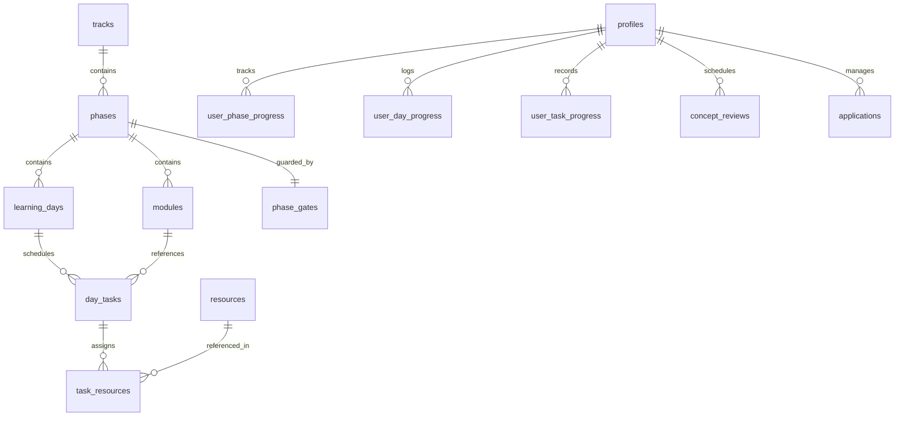

# Postgres Data Model & Database Architecture
**System Name:** FOUNDATION — Day-Based Career Preparation Operating System  
**Version:** 1.0.0

---

## 1. Architectural Architecture: Shared Curriculum vs. Private User Space

To ensure rock-solid data integrity, scalability, and multi-tenant isolation, the database schema strictly segregates **read-only shared curriculum data** from **private user progress and telemetry**.



---

## 2. Shared Curriculum Tables (System Managed / Public Read)

### 2.1 `curriculum_versions`
Tracks versioning and integrity hashes of the underlying curriculum.
- `id` (UUID, Primary Key)
- `version_tag` (TEXT, e.g., '1.0.0')
- `source_sha256` (TEXT, NOT NULL)
- `status` (TEXT, 'active' | 'deprecated')
- `created_at` (TIMESTAMPTZ, DEFAULT NOW())

### 2.2 `phases`
- `id` (TEXT, Primary Key, e.g., 'P0', 'P1', ..., 'P8')
- `track_id` (TEXT, NOT NULL, DEFAULT 'sde-foundation')
- `order_index` (INTEGER, NOT NULL)
- `title` (TEXT, NOT NULL)
- `description` (TEXT, NOT NULL)
- `estimated_hours` (TEXT, NOT NULL)
- `approx_study_days` (TEXT, NOT NULL)
- `prerequisite_phase_id` (TEXT NULL REFERENCES phases(id))
- `optional_parallel` (BOOLEAN, DEFAULT FALSE)
- `created_at` (TIMESTAMPTZ, DEFAULT NOW())

### 2.3 `subjects`
- `id` (TEXT, Primary Key, e.g., 'CPP', 'DSA', 'DB', 'CS', 'BE', 'AI')
- `slug` (TEXT, UNIQUE, NOT NULL)
- `title` (TEXT, NOT NULL)
- `description` (TEXT)

### 2.4 `modules`
- `id` (TEXT, Primary Key, e.g., 'P0.01', 'P1.03', 'DSA-04')
- `phase_id` (TEXT NOT NULL REFERENCES phases(id))
- `subject_id` (TEXT NOT NULL REFERENCES subjects(id))
- `order_index` (INTEGER, NOT NULL)
- `title` (TEXT, NOT NULL)
- `expected_minutes` (INTEGER NOT NULL DEFAULT 90)
- `learning_outcomes` (JSONB NOT NULL DEFAULT '[]'::jsonb)
- `prereq_codes` (TEXT[] DEFAULT '{}')

### 2.5 `learning_days`
Represents pure integer learning sequences (`learning_day_index`), **never calendar dates**.
- `id` (TEXT, Primary Key, e.g., 'P0-D01', 'P0-D02', ..., 'P1-D01')
- `phase_id` (TEXT NOT NULL REFERENCES phases(id))
- `sequence_index` (INTEGER NOT NULL) -- Absolute sequential index 1, 2, 3...
- `title` (TEXT, NOT NULL)
- `goal` (TEXT, NOT NULL) -- Exactly one crisp sentence of capability
- `estimated_minutes` (INTEGER NOT NULL DEFAULT 90)
- `curriculum_version_id` (UUID REFERENCES curriculum_versions(id))

### 2.6 `day_tasks`
- `id` (TEXT, Primary Key, e.g., 'P0-D01-T01')
- `learning_day_id` (TEXT NOT NULL REFERENCES learning_days(id))
- `module_id` (TEXT REFERENCES modules(id))
- `task_order` (INTEGER NOT NULL)
- `kind` (TEXT NOT NULL CHECK (kind IN ('learn', 'practice', 'apply', 'review')))
- `required` (BOOLEAN NOT NULL DEFAULT TRUE)
- `title` (TEXT, NOT NULL)
- `instructions` (TEXT NOT NULL)
- `estimate_minutes` (INTEGER NOT NULL)
- `validation_criteria` (TEXT NOT NULL)

### 2.7 `resources` (`R01` through `R41`)
- `id` (TEXT, Primary Key, e.g., 'R01', 'R02', ..., 'R41')
- `title` (TEXT, NOT NULL)
- `url` (TEXT, NOT NULL)
- `provider` (TEXT, NOT NULL)
- `access_level` (TEXT NOT NULL DEFAULT 'free')
- `verification_status` (TEXT NOT NULL DEFAULT 'checked')
- `source_confidence` (TEXT NOT NULL DEFAULT 'official')
- `source_notes` (TEXT)
- `avoid_notes` (TEXT)

### 2.8 `task_resources`
- `task_id` (TEXT NOT NULL REFERENCES day_tasks(id))
- `resource_id` (TEXT NOT NULL REFERENCES resources(id))
- `exact_assigned_sections` (TEXT NOT NULL)
- `purpose` (TEXT NOT NULL)
- `note_what_to_skip` (TEXT)
- PRIMARY KEY (task_id, resource_id)

### 2.9 `phase_gates`
- `id` (TEXT, Primary Key, e.g., 'GATE-P0')
- `phase_id` (TEXT NOT NULL UNIQUE REFERENCES phases(id))
- `title` (TEXT, NOT NULL)
- `rubric_json` (JSONB NOT NULL)
- `pass_criteria` (TEXT NOT NULL)
- `suggested_review_module_ids` (TEXT[] DEFAULT '{}')

### 2.10 `project_templates`
- `id` (TEXT, Primary Key, e.g., 'PROJ-A', 'PROJ-B', 'PROJ-C')
- `phase_id` (TEXT NOT NULL REFERENCES phases(id))
- `name` (TEXT, NOT NULL)
- `tagline` (TEXT, NOT NULL)
- `description` (TEXT, NOT NULL)
- `tech_stack` (TEXT[] NOT NULL)
- `milestones_json` (JSONB NOT NULL)

---

## 3. Private User Tables (Strict Row Level Security)

All user tables require `user_id UUID NOT NULL REFERENCES auth.users(id) ON DELETE CASCADE`.

### 3.1 `profiles`
- `user_id` (UUID, Primary Key REFERENCES auth.users(id))
- `alias` (TEXT NOT NULL)
- `academic_semester` (TEXT NOT NULL DEFAULT '2-2')
- `target_role` (TEXT NOT NULL DEFAULT 'SDE / Backend')
- `optional_cgpa` (NUMERIC(3, 2) NULL)
- `preferred_daily_minutes` (INTEGER NOT NULL DEFAULT 90 CHECK (preferred_daily_minutes IN (45, 60, 90, 120, 150)))
- `preferred_mode` (TEXT NOT NULL DEFAULT 'normal' CHECK (preferred_mode IN ('light', 'normal', 'deep', 'maintenance')))
- `theme` (TEXT NOT NULL DEFAULT 'light' CHECK (theme IN ('light', 'dark', 'system')))
- `onboarding_status` (TEXT NOT NULL DEFAULT 'completed')
- `active_day_index` (INTEGER NOT NULL DEFAULT 1)
- `created_at` (TIMESTAMPTZ DEFAULT NOW())
- `updated_at` (TIMESTAMPTZ DEFAULT NOW())

### 3.2 `user_day_progress`
- `user_id` (UUID NOT NULL REFERENCES auth.users(id))
- `learning_day_id` (TEXT NOT NULL REFERENCES learning_days(id))
- `state` (TEXT NOT NULL DEFAULT 'not_started' CHECK (state IN ('not_started', 'in_progress', 'completed', 'skipped')))
- `started_at` (TIMESTAMPTZ)
- `completed_at` (TIMESTAMPTZ)
- `notes` (TEXT)
- `time_spent_minutes` (INTEGER DEFAULT 0)
- `self_rating` (TEXT CHECK (self_rating IN ('confident', 'needs_review')))
- PRIMARY KEY (user_id, learning_day_id)

### 3.3 `user_task_progress`
- `user_id` (UUID NOT NULL REFERENCES auth.users(id))
- `day_task_id` (TEXT NOT NULL REFERENCES day_tasks(id))
- `status` (TEXT NOT NULL DEFAULT 'not_started' CHECK (status IN ('not_started', 'completed', 'skipped_optional')))
- `evidence_text` (TEXT)
- `evidence_url` (TEXT)
- `completed_at` (TIMESTAMPTZ)
- PRIMARY KEY (user_id, day_task_id)

### 3.4 `concept_reviews` (Spaced Repetition Queue)
Offsets are based on **completed active study days**: `+1, +3, +7, +21, +45`.
- `id` (UUID PRIMARY KEY DEFAULT gen_random_uuid())
- `user_id` (UUID NOT NULL REFERENCES auth.users(id))
- `module_id` (TEXT NOT NULL REFERENCES modules(id))
- `concept_prompt` (TEXT NOT NULL)
- `concept_answer` (TEXT NOT NULL)
- `last_studied_day_index` (INTEGER NOT NULL)
- `next_due_day_index` (INTEGER NOT NULL)
- `interval_step` (INTEGER NOT NULL DEFAULT 1)
- `latest_confidence` (TEXT DEFAULT 'needs_work' CHECK (latest_confidence IN ('needs_work', 'stable')))
- `mistake_tag` (TEXT)
- `updated_at` (TIMESTAMPTZ DEFAULT NOW())

### 3.5 `gate_attempts`
- `id` (UUID PRIMARY KEY DEFAULT gen_random_uuid())
- `user_id` (UUID NOT NULL REFERENCES auth.users(id))
- `phase_id` (TEXT NOT NULL REFERENCES phases(id))
- `passed` (BOOLEAN NOT NULL)
- `score_json` (JSONB NOT NULL)
- `evidence` (TEXT NOT NULL)
- `created_at` (TIMESTAMPTZ DEFAULT NOW())

### 3.6 `applications` (Personal Pipeline CRM)
- `id` (UUID PRIMARY KEY DEFAULT gen_random_uuid())
- `user_id` (UUID NOT NULL REFERENCES auth.users(id))
- `company` (TEXT NOT NULL)
- `role` (TEXT NOT NULL)
- `location` (TEXT NOT NULL DEFAULT 'India / Remote')
- `url` (TEXT)
- `kind` (TEXT NOT NULL DEFAULT 'internship' CHECK (kind IN ('internship', 'full_time', 'research', 'open_source')))
- `status` (TEXT NOT NULL DEFAULT 'saved' CHECK (status IN ('saved', 'applied', 'oa', 'interview', 'offer', 'rejected', 'withdrawn')))
- `eligibility_notes` (TEXT)
- `notes` (TEXT)
- `created_at` (TIMESTAMPTZ DEFAULT NOW())
- `updated_at` (TIMESTAMPTZ DEFAULT NOW())

---

## 4. Row-Level Security (RLS) Policies

All public/curriculum tables are granted `SELECT` to public and authenticated roles, and writeable only by migration/service role.

For private tables:
```sql
ALTER TABLE profiles ENABLE ROW LEVEL SECURITY;
CREATE POLICY "Users view own profile" ON profiles FOR SELECT USING (auth.uid() = user_id);
CREATE POLICY "Users update own profile" ON profiles FOR UPDATE USING (auth.uid() = user_id) WITH CHECK (auth.uid() = user_id);
CREATE POLICY "Users insert own profile" ON profiles FOR INSERT WITH CHECK (auth.uid() = user_id);

ALTER TABLE user_day_progress ENABLE ROW LEVEL SECURITY;
CREATE POLICY "Users manage own day progress" ON user_day_progress FOR ALL USING (auth.uid() = user_id) WITH CHECK (auth.uid() = user_id);

ALTER TABLE user_task_progress ENABLE ROW LEVEL SECURITY;
CREATE POLICY "Users manage own task progress" ON user_task_progress FOR ALL USING (auth.uid() = user_id) WITH CHECK (auth.uid() = user_id);

ALTER TABLE concept_reviews ENABLE ROW LEVEL SECURITY;
CREATE POLICY "Users manage own concept reviews" ON concept_reviews FOR ALL USING (auth.uid() = user_id) WITH CHECK (auth.uid() = user_id);

ALTER TABLE applications ENABLE ROW LEVEL SECURITY;
CREATE POLICY "Users manage own applications" ON applications FOR ALL USING (auth.uid() = user_id) WITH CHECK (auth.uid() = user_id);
```

---

## 5. Atomic RPC Operations: `finish_learning_day`

```sql
CREATE OR REPLACE FUNCTION finish_learning_day(p_day_id TEXT)
RETURNS JSONB
LANGUAGE plpgsql
SECURITY DEFINER
SET search_path = public
AS $$
DECLARE
  v_user_id UUID := auth.uid();
  v_incomplete_required_count INT;
  v_current_seq INT;
  v_target_seq INT;
  v_next_day_id TEXT;
BEGIN
  IF v_user_id IS NULL THEN
    RAISE EXCEPTION 'Not authenticated';
  END IF;

  -- Verify all required tasks for this learning day are completed
  SELECT COUNT(*)
  INTO v_incomplete_required_count
  FROM day_tasks dt
  LEFT JOIN user_task_progress utp 
    ON utp.day_task_id = dt.id AND utp.user_id = v_user_id
  WHERE dt.learning_day_id = p_day_id
    AND dt.required = TRUE
    AND (utp.status IS NULL OR utp.status != 'completed');

  IF v_incomplete_required_count > 0 THEN
    RETURN jsonb_build_object(
      'success', false,
      'error', 'incomplete_required_tasks',
      'remaining_count', v_incomplete_required_count
    );
  END IF;

  -- Mark day completed
  INSERT INTO user_day_progress (user_id, learning_day_id, state, completed_at)
  VALUES (v_user_id, p_day_id, 'completed', NOW())
  ON CONFLICT (user_id, learning_day_id)
  DO UPDATE SET state = 'completed', completed_at = NOW();

  -- Advance active sequence in user profile
  SELECT sequence_index INTO v_target_seq FROM learning_days WHERE id = p_day_id;
  
  UPDATE profiles
  SET active_day_index = GREATEST(active_day_index, v_target_seq + 1),
      updated_at = NOW()
  WHERE user_id = v_user_id;

  RETURN jsonb_build_object(
    'success', true,
    'completed_day_id', p_day_id,
    'next_day_sequence', v_target_seq + 1
  );
END;
$$;
```
